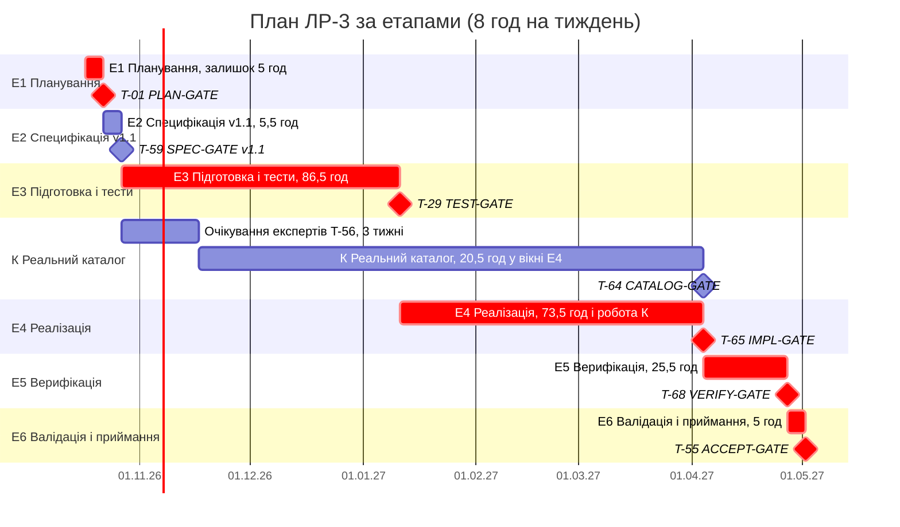

# Поетапний план робіт

**Статус:** draft — пропозиція агента, рішення приймає людина
**Дата:** 17.10.2026
**Підготував:** кодинговий агент (Claude Code), за запитом людини
**Джерела:** `docs/plan/decomposition.md` (затверджено 17.10.2026, крок 2), `docs/plan/dependencies.md` (затверджено 17.10.2026, крок 4), `docs/plan/roles.md`, `docs/plan/high-risk-requirements.md`; `docs/plan/decomposition-review.md` (PR-05, PR-06, PR-08)

План деталізовано до рівня тікета. Нових тікетів, гейтів і залежностей план не вводить: етапи побудовано навколо гейтів, уже затверджених у `decomposition.md` (PR-06 і рішення кроку 4). Критичний шлях, календар і діаграму Ганта на рівні етапів наведено в розділі 6.

## 1. Етапи

Принцип: один етап — один затверджений Gate. Менше етапів не виходить без того, щоб один етап закривався двома незалежними гейтами. Етап К — паралельний трек: він залежить від зовнішньої консультації T-56 і за рішенням 6.1 (`dependencies.md`) не блокує IMPL-GATE.

| Етап | Назва | Тікети етапу | Гейт | Умова входу | Файл рішення | Агент, год (сума) | Людина, год (сума) |
|---|---|---|---|---|---|---|---|
| Е1 | Планування | — (поточна робота з планування ЛР-3 у `docs/plan/`) | T-01 PLAN-GATE | — | `logs/plan-gate.md` | 0 | 10 (планування 8 + T-01 2) |
| Е2 | Специфікація v1.1 | T-58 | T-59 SPEC-GATE v1.1 | — (паралельно з Е1) | `logs/spec-gate.md` | 2 | 3,5 |
| Е3 | Підготовка і тести | T-02, T-05–T-10, T-11–T-28, T-57, T-61, T-62 | T-29 TEST-GATE | GO на T-01 і T-59 | `logs/test-gate.md` | 62 | 24,5 |
| Е4 | Реалізація | T-30–T-48 | T-65 IMPL-GATE | GO на T-29 | `logs/impl-gate.md` | 51,5 | 22 |
| К | Реальний каталог (паралельний трек) | T-56, T-03, T-04, T-63 | T-64 CATALOG-GATE | T-56 — після T-02 (Е3); T-03 — після T-59; T-63 — після T-32 (Е4) | `logs/catalog-gate.md` | 2,5 | 18 (+ 3 календарні тижні очікування T-56) |
| Е5 | Верифікація | T-49–T-54, T-66, T-67 | T-68 VERIFY-GATE | GO на T-65; для T-49 і T-67 — також GO на T-64 | `logs/verify-gate.md` | 11 | 14,5 |
| Е6 | Валідація і приймання | T-60 | T-55 ACCEPT-GATE | GO на T-68; T-56 закрито | `logs/accept-gate.md` | 0 | 5 |

Разом «Агент, год»: 129. Разом «Людина, год»: 97,5 (89,5 за тікетами + 8 на планування Е1). Очікування T-56 (3 календарні тижні) до робочих годин не входить. Припущення — розділ 3.

### 1.1. Гейти етапів

Умови GO взято з `decomposition.md` і рішень людини; план їх не змінює.

| Гейт | Що перевіряє людина (за чинними документами) |
|---|---|
| T-01 PLAN-GATE | Покриття вимог SRS v1.1 з ADD-001 тікетами; узгодженість залежностей без циклів; гейти перед критичними переходами; відсутність функціональності поза SRS v1.1; заходи щодо значущих ризиків (умова GO, визначена людиною 17.10.2026) |
| T-59 SPEC-GATE v1.1 | Повторна перевірка специфікації після застосування ADD-001 (T-58) |
| T-29 TEST-GATE | Перегляд тестів перед стартом реалізації з чек-листом вимог посиленого контролю: T-18, T-20, T-19, T-25, T-26, T-15 (`decomposition.md`, T-29) |
| T-65 IMPL-GATE | Усі тести проходять; тести, затверджені на T-29, не послаблено (diff тестових файлів відносно коміту рішення T-29); усі Feature T-10, T-30–T-48 закрито |
| T-64 CATALOG-GATE | Звірка кожної межі навантаження, назв, режимів, `e`, етапів, відеоданих і авторства у збірці з T-03; релізна збірка без `[TEST]`-вправ (D-26) |
| T-68 VERIFY-GATE | Кожен із T-49–T-53, T-66, T-67 має результат у `logs/verification.md`; немає відкритих дефектів за `high-risk-requirements.md` |
| T-55 ACCEPT-GATE | Рішення про приймання після T-60 і T-68; зокрема заповнена матриця простежуваності (T-09). Рішення — `logs/accept-gate.md` (як у тілі issue #56) |

### 1.2. TEST-GATE і IMPL-GATE не розділяються

Усі Test-тікети (T-11–T-28, T-61, T-62) вміщуються в один етап Е3 до реалізації, а вся реалізація T-30–T-48 — в один етап Е4. Тому T-29 TEST-GATE і T-65 IMPL-GATE залишаються одиночними тікетами.

**Примітку PR-08 про розділення T-29 на окремі TEST-GATE для кожного етапу (`decomposition-review.md`; примітка в назві T-29 у `decomposition.md`) закрито цим рішенням.** Чек-лист T-29 ні в які інші гейти не переходить, бо TEST-GATE лише один. Примітку в `decomposition.md` і в issue #30 буде оновлено одним пакетом перед PLAN-GATE (рішення людини 17.10.2026).

### 1.3. Критичний шлях

T-56 → T-03 → T-63 → T-64 → T-49 / T-67 → T-68 → T-60 → T-55 (`dependencies.md`, 6.3; RISK-02). У термінах етапів: трек К має закритися T-64 до того, як Е5 зможе завершитися. T-63 стартує лише після T-32, тому трек К також чекає частину Е4.

Це логічний ланцюжок до приймання, визначений до появи оцінок. У робочих годинах критичним є інший шлях — через Е3 і Е4, а трек К має резерв (розділ 6.1).

## 2. Тікети за етапами

Виконавця взято з колонки «Виконавець» `decomposition.md` (Людина → Human, Спільно → Joint, Агент → Agent). «Агент, год» заповнено для Agent і для агентської частини Joint; для Human агентської частини немає (—). «Людина, год» заповнено за правилами людини (розділ 3): для Agent — час перегляду результату, для Joint — людська частина, для Human — уся робота. T-03 і T-56 мають виконавця Human свідомо: каталог і консультацію з експертами виконує лише людина (CON-005).

| ID | Етап | Тип | Виконавець | Залежить від | Агент, год | Людина, год |
|---|---|---|---|---|---|---|
| T-01 | Е1 | Gate | Human | — | — | 2 |
| T-58 | Е2 | Addendum | Joint | — | 2 | 1,5 |
| T-59 | Е2 | Gate | Human | T-58 | — | 2 |
| T-02 | Е3 | Specification | Joint | T-01 | 1 | 1,5 |
| T-05 | Е3 | Specification | Joint | T-02, T-59 | 3 | 1,5 |
| T-06 | Е3 | Specification | Joint | T-01 | 1 | 1,5 |
| T-07 | Е3 | Documentation | Agent | T-01, T-59 | 2 | 0,5 |
| T-08 | Е3 | Documentation | Joint | T-01, T-59 | 3 | 1,5 |
| T-09 | Е3 | Documentation | Joint | T-01, T-59 | 0,5 | 1,5 |
| T-10 | Е3 | Feature | Agent | T-01, T-06 | 2 | 1 |
| T-57 | Е3 | Specification | Joint | T-02, T-59 | 1,5 | 1,5 |
| T-11 | Е3 | Test | Agent | T-10, T-59 | 2 | 0,5 |
| T-12 | Е3 | Test | Agent | T-07, T-10, T-59 | 2,5 | 0,5 |
| T-13 | Е3 | Test | Agent | T-10, T-57, T-59 | 2,5 | 0,5 |
| T-14 | Е3 | Test | Agent | T-02, T-10, T-59 | 2 | 0,5 |
| T-15 | Е3 | Test | Agent | T-10, T-59 | 2 | 0,5 |
| T-16 | Е3 | Test | Agent | T-10, T-59 | 2,5 | 0,5 |
| T-17 | Е3 | Test | Agent | T-10 | 1 | 0,5 |
| T-18 | Е3 | Test | Agent | T-10 | 1,5 | 0,5 |
| T-19 | Е3 | Test | Agent | T-05, T-10, T-59 | 3 | 0,5 |
| T-20 | Е3 | Test | Agent | T-05, T-08, T-10, T-59 | 3,5 | 0,5 |
| T-21 | Е3 | Test | Agent | T-10, T-59 | 2 | 0,5 |
| T-22 | Е3 | Test | Agent | T-10, T-59 | 3 | 0,5 |
| T-23 | Е3 | Test | Agent | T-10, T-59 | 2 | 0,5 |
| T-24 | Е3 | Test | Agent | T-10, T-59 | 2 | 0,5 |
| T-25 | Е3 | Test | Agent | T-10, T-59 | 2,5 | 0,5 |
| T-26 | Е3 | Test | Agent | T-10, T-59 | 2 | 0,5 |
| T-27 | Е3 | Test | Agent | T-05, T-10, T-59 | 3 | 0,5 |
| T-28 | Е3 | Test | Agent | T-05, T-06, T-10 | 3 | 0,5 |
| T-61 | Е3 | Test | Agent | T-10, T-59 | 3 | 0,5 |
| T-62 | Е3 | Test | Agent | T-10, T-59 | 3 | 0,5 |
| T-29 | Е3 | Gate | Human | T-11–T-28, T-61, T-62 | — | 4 |
| T-30 | Е4 | Feature | Agent | T-11, T-29, T-59 | 2 | 1 |
| T-31 | Е4 | Feature | Agent | T-07, T-12, T-29, T-59 | 3 | 1 |
| T-32 | Е4 | Feature | Agent | T-13, T-29, T-30, T-31, T-57, T-59 | 3 | 1 |
| T-33 | Е4 | Feature | Agent | T-14, T-29, T-30, T-59 | 2 | 1 |
| T-34 | Е4 | Feature | Agent | T-15, T-29, T-30, T-59 | 1,5 | 1 |
| T-35 | Е4 | Feature | Agent | T-16, T-29, T-31, T-33, T-34, T-59 | 4 | 1 |
| T-36 | Е4 | Feature | Agent | T-17, T-29 | 1 | 1 |
| T-37 | Е4 | Feature | Agent | T-18, T-29 | 1 | 1 |
| T-38 | Е4 | Feature | Agent | T-19, T-29, T-30, T-36, T-59 | 2 | 1 |
| T-39 | Е4 | Feature | Agent | T-08, T-20, T-29, T-37, T-38, T-59 | 5 | 1 |
| T-40 | Е4 | Feature | Agent | T-21, T-29, T-36, T-39, T-59 | 3 | 1 |
| T-41 | Е4 | Feature | Agent | T-22, T-29, T-37, T-59 | 3 | 1 |
| T-42 | Е4 | Feature | Agent | T-23, T-29, T-31, T-41, T-59 | 3 | 1 |
| T-43 | Е4 | Feature | Agent | T-29, T-41, T-42, T-44, T-59, T-61 | 4 | 1 |
| T-44 | Е4 | Feature | Agent | T-24, T-29, T-42, T-59 | 2,5 | 1 |
| T-45 | Е4 | Feature | Agent | T-25, T-29, T-31, T-44, T-59, T-62 | 3 | 1 |
| T-46 | Е4 | Feature | Agent | T-26, T-29, T-45, T-59, T-62 | 2,5 | 1 |
| T-47 | Е4 | Feature | Agent | T-27, T-29, T-45, T-59 | 3 | 1 |
| T-48 | Е4 | Feature | Agent | T-27, T-29, T-47, T-59, T-62 | 3 | 1 |
| T-65 | Е4 | Gate | Human | T-10, T-30–T-48 | — | 3 |
| T-56 | К | Specification | Human | T-02 | — | 8 (+ 3 календарні тижні очікування — не робочий час) |
| T-03 | К | Specification | Human | T-02, T-56, T-59 | — | 4 |
| T-04 | К | Specification | Joint | T-03, T-56 | 1 | 2 |
| T-63 | К | Feature | Agent | T-03, T-32 | 1,5 | 1 |
| T-64 | К | Gate | Human | T-63 | — | 3 |
| T-49 | Е5 | Verification | Joint | T-04, T-32, T-39, T-64, T-65 | 1 | 1,5 |
| T-50 | Е5 | Verification | Joint | T-06, T-28, T-32, T-35, T-40, T-43, T-46, T-48, T-65 | 1 | 1,5 |
| T-51 | Е5 | Verification | Joint | T-34, T-50, T-65 | 1,5 | 1,5 |
| T-52 | Е5 | Verification | Joint | T-35, T-40, T-43, T-45, T-46, T-48, T-65 | 2 | 1,5 |
| T-53 | Е5 | Verification | Joint | T-09, T-30–T-48, T-65 | 2 | 1,5 |
| T-66 | Е5 | Verification | Joint | T-05, T-08, T-39, T-40, T-65 | 2 | 1,5 |
| T-67 | Е5 | Verification | Joint | T-06, T-32, T-42, T-46, T-48, T-63, T-64, T-65 | 1,5 | 1,5 |
| T-54 | Е5 | Validation | Human | T-50, T-57 | — | 2 |
| T-68 | Е5 | Gate | Human | T-49–T-53, T-66, T-67 | — | 2 |
| T-60 | Е6 | Validation | Human | T-49, T-50, T-56, T-68 | — | 3 |
| T-55 | Е6 | Gate | Human | T-60, T-68 | — | 2 |

Розподіл за виконавцем у таблиці: Agent — 42, Joint — 15, Human — 11 (68 тікетів).

## 3. Припущення щодо оцінок

**Правила людини для «Людина, год»** (17.10.2026):

| Що оцінюється | Год |
|---|---|
| Перегляд результату Agent-тікета: Test | 0,5 |
| Перегляд результату Agent-тікета: Feature | 1 |
| Перегляд результату Agent-тікета: Documentation | 0,5 |
| Людська частина Joint-тікета (крім T-04) | 1,5 |
| Гейти: T-01 — 2; T-59 — 2; T-29 — 4; T-65 — 3; T-64 — 3; T-68 — 2; T-55 — 2 | — |
| Валідація: T-54 — 2; T-60 — 3 | — |
| T-03 — 4; T-04 — 2 | — |
| T-56 — 8 год роботи; окремо 3 календарні тижні очікування експертів. Очікування не є робочим часом і до сум не входить | 8 |
| Е1, планування ЛР-3: витрачено 5, заплановано ще 3 (без T-01) | 8 |

**Доступність людини:** 8 год на тиждень.

**Календарний час.** Агент працює лише під час сесій людини, тому агентські години також займають календарний час людини. Календарне навантаження етапу = «Агент, год» + «Людина, год»:

| Етап | Агент, год | Людина, год | Календарне навантаження, год |
|---|---|---|---|
| Е1 | 0 | 10 | 10 |
| Е2 | 2 | 3,5 | 5,5 |
| Е3 | 62 | 24,5 | 86,5 |
| Е4 | 51,5 | 22 | 73,5 |
| К | 2,5 | 18 | 20,5 (+ 3 тижні очікування T-56) |
| Е5 | 11 | 14,5 | 25,5 |
| Е6 | 0 | 5 | 5 |
| **Разом** | **129** | **97,5** | **226,5** |

Тривалість ≈ 226,5 / 8 ≈ 28,3 тижня (≈ 29 календарних тижнів), бо всі години, людські й агентські, займають ті самі 8 год на тиждень. Очікування T-56 (3 тижні) йде паралельно з Е3–Е4 (разом 160 год ≈ 20 тижнів) і план не подовжує, якщо T-56 стартує одразу після T-02. Оцінка не містить резерву на доопрацювання після REVISE на гейтах.

## 4. Тікети етапу поза умовою його гейту

Ці тікети стоять у своєму етапі за залежностями, але гейт етапу їх не досягає. Людина 17.10.2026 підтвердила, що контролю нижче досить:

| Тікет | Етап | Чому поза гейтом | Де перевіряється |
|---|---|---|---|
| T-09 | Е3 | T-29 від нього не залежить | T-55 ACCEPT-GATE (умова про заповнену матрицю); також T-53 |
| T-04 | К | T-64 звіряє лише каталог T-03, без контрольних параметрів | T-49 (Е5) → T-68 |
| T-54 | Е5 | Інформаційна валідація, свідомо не входить до T-68 | — (не розблоковує ACCEPT-GATE) |

## 5. Відповіді людини на питання (17.10.2026)

| № | Питання | Відповідь |
|---|---|---|
| 1 | Розбіжність підрахунку виконавців у `roles.md` (45 / 15 / 11) і `decomposition.md` | Правильно 42 / 15 / 11 за `decomposition.md`; `roles.md` виправляє людина |
| 2 | T-03 і T-56 (Specification) з виконавцем Human | Свідомий виняток: каталог і консультацію з експертами виконує лише людина |
| 3 | T-09, T-04, T-54 поза гейтом етапу | Досить: T-09 — на ACCEPT-GATE, T-04 — через T-49, T-54 інформаційний |
| 4 | Е1 без робочих тікетів | Е1 залишається окремим етапом: це поточна робота з планування, її людський час реальний |
| 5 | Файл рішення T-55 | `logs/accept-gate.md`, як у тілі issue #56 |

Години на планування ЛР-3 (8) і доступність (8 год на тиждень) надано людиною 17.10.2026.

## 6. Критичний шлях і календар

**Метод.** Розрахунок методом критичного шляху (CPM) скриптом агента за таблицею розділу 2: прямий прохід дає ранні строки (РП — ранній початок, РЗ — раннє завершення), зворотний — пізні (ПП, ПЗ); резерв = ПП − РП. Тривалість тікета = «Агент, год» + «Людина, год», бо агент працює лише під час сесій людини (розділ 3). Планування Е1 (8 год) враховано як окрему роботу «П» перед T-01. Діапазони в колонці «Залежить від» (T-11–T-28, T-30–T-48, T-49–T-53) розгорнуто. Очікування T-56 (3 тижні) у розділах 6.1–6.2 до робочих годин не входить; його враховано в розділі 6.3.

CPM припускає, що незалежні тікети можна виконувати паралельно без обмежень. Тому довжина критичного шляху — нижня межа за залежностями, а не реальна тривалість для одного виконавця (розділ 6.3).

### 6.1. Критичний шлях у робочих годинах (усі дії)

**Довжина критичного шляху: 66 год.** Шлях: П → T-01 → T-02 → T-05 → T-20 → T-29 → T-37 → T-41 → T-42 → T-44 → T-45 → T-47 → T-48 → T-65 → T-50 → T-51 → T-68 → T-60 → T-55.

| Тікет | Етап | Тривалість, год | РП | РЗ | ПП | ПЗ | Резерв |
|---|---|---|---|---|---|---|---|
| П (планування) | Е1 | 8 | 0 | 8 | 0 | 8 | 0 |
| T-01 | Е1 | 2 | 8 | 10 | 8 | 10 | 0 |
| T-02 | Е3 | 2,5 | 10 | 12,5 | 10 | 12,5 | 0 |
| T-05 | Е3 | 4,5 | 12,5 | 17 | 12,5 | 17 | 0 |
| T-20 | Е3 | 4 | 17 | 21 | 17 | 21 | 0 |
| T-29 | Е3 | 4 | 21 | 25 | 21 | 25 | 0 |
| T-37 | Е4 | 2 | 25 | 27 | 25 | 27 | 0 |
| T-41 | Е4 | 4 | 27 | 31 | 27 | 31 | 0 |
| T-42 | Е4 | 4 | 31 | 35 | 31 | 35 | 0 |
| T-44 | Е4 | 3,5 | 35 | 38,5 | 35 | 38,5 | 0 |
| T-45 | Е4 | 4 | 38,5 | 42,5 | 38,5 | 42,5 | 0 |
| T-47 | Е4 | 4 | 42,5 | 46,5 | 42,5 | 46,5 | 0 |
| T-48 | Е4 | 4 | 46,5 | 50,5 | 46,5 | 50,5 | 0 |
| T-65 | Е4 | 3 | 50,5 | 53,5 | 50,5 | 53,5 | 0 |
| T-50 | Е5 | 2,5 | 53,5 | 56 | 53,5 | 56 | 0 |
| T-51 | Е5 | 3 | 56 | 59 | 56 | 59 | 0 |
| T-68 | Е5 | 2 | 59 | 61 | 59 | 61 | 0 |
| T-60 | Е6 | 3 | 61 | 64 | 61 | 64 | 0 |
| T-55 | Е6 | 2 | 64 | 66 | 64 | 66 | 0 |

Майже критичні (резерв 0,5 год): T-19, T-27, T-28 — паралельно з T-20 перед T-29.

**Найдовші паралельні ланцюжки:**

| Ланцюжок | Тікет | Тривалість, год | РП | РЗ | ПП | ПЗ | Резерв |
|---|---|---|---|---|---|---|---|
| Трек К (реальний каталог) | T-56 | 8 | 12,5 | 20,5 | 38,5 | 46,5 | 26 |
| | T-03 | 4 | 20,5 | 24,5 | 46,5 | 50,5 | 26 |
| | T-04 | 3 | 24,5 | 27,5 | 53,5 | 56,5 | 29 |
| | T-63 | 2,5 | 33 | 35,5 | 50,5 | 53 | 17,5 |
| | T-64 | 3 | 35,5 | 38,5 | 53 | 56 | 17,5 |
| | T-49 | 2,5 | 53,5 | 56 | 56,5 | 59 | 3 |
| | T-67 | 3 | 53,5 | 56,5 | 56 | 59 | 2,5 |
| Генератор плану | T-08 | 4,5 | 10 | 14,5 | 12,5 | 17 | 2,5 |
| | T-36 | 2 | 25 | 27 | 35,5 | 37,5 | 10,5 |
| | T-38 | 3 | 28 | 31 | 37,5 | 40,5 | 9,5 |
| | T-39 | 6 | 31 | 37 | 40,5 | 46,5 | 9,5 |
| | T-40 | 4 | 37 | 41 | 46,5 | 50,5 | 9,5 |
| | T-66 | 3,5 | 53,5 | 57 | 55,5 | 59 | 2 |
| Сховище і каталог | T-31 | 4 | 25 | 29 | 27 | 31 | 2 |
| | T-30 | 3 | 25 | 28 | 34,5 | 37,5 | 9,5 |
| | T-32 | 4 | 29 | 33 | 46,5 | 50,5 | 17,5 |
| | T-33 | 3 | 28 | 31 | 42,5 | 45,5 | 14,5 |
| | T-35 | 5 | 31 | 36 | 45,5 | 50,5 | 14,5 |
| | T-43 | 5 | 38,5 | 43,5 | 45,5 | 50,5 | 7 |
| Специфікація v1.1 (Е2) | T-58 | 3,5 | 0 | 3,5 | 7 | 10,5 | 7 |
| | T-59 | 2 | 3,5 | 5,5 | 10,5 | 12,5 | 7 |
| Окремі тікети | T-09 | 2 | 10 | 12 | 53,5 | 55,5 | 43,5 |
| | T-54 | 2 | 56 | 58 | 64 | 66 | 8 |

**Висновок.** Логічний ланцюжок із розділу 1.3 (T-56 → T-03 → T-63 → T-64 → …) у робочих годинах не критичний: T-56 має резерв 26 год. Робочий критичний шлях проходить через Feature редагування плану, заняття, завершення й аналітики (T-41 → T-42 → T-44 → T-45 → T-47 → T-48), і цей ланцюжок сформовано наскрізними залежностями `decomposition.md`.

### 6.2. Критичний шлях, якщо людські дії тривають 0 год

Тривалість тікета = лише «Агент, год»; гейти, валідації, T-03, T-56 і планування — 0 год.

**Довжина критичного шляху: 29,5 год.** Шлях: T-58 → T-59 → T-05 / T-08 → T-20 → T-29 → T-37 → T-41 → T-42 → T-44 → T-45 → T-47 → T-48 → T-65 → T-50 → T-51 → T-68 → T-60 → T-55.

| Тікет | Етап | Тривалість, год | РП | РЗ | ПП | ПЗ | Резерв |
|---|---|---|---|---|---|---|---|
| T-58 | Е2 | 2 | 0 | 2 | 0 | 2 | 0 |
| T-59 | Е2 | 0 | 2 | 2 | 2 | 2 | 0 |
| T-05 | Е3 | 3 | 2 | 5 | 2 | 5 | 0 |
| T-08 | Е3 | 3 | 2 | 5 | 2 | 5 | 0 |
| T-20 | Е3 | 3,5 | 5 | 8,5 | 5 | 8,5 | 0 |
| T-29 | Е3 | 0 | 8,5 | 8,5 | 8,5 | 8,5 | 0 |
| T-37 | Е4 | 1 | 8,5 | 9,5 | 8,5 | 9,5 | 0 |
| T-41 | Е4 | 3 | 9,5 | 12,5 | 9,5 | 12,5 | 0 |
| T-42 | Е4 | 3 | 12,5 | 15,5 | 12,5 | 15,5 | 0 |
| T-44 | Е4 | 2,5 | 15,5 | 18 | 15,5 | 18 | 0 |
| T-45 | Е4 | 3 | 18 | 21 | 18 | 21 | 0 |
| T-47 | Е4 | 3 | 21 | 24 | 21 | 24 | 0 |
| T-48 | Е4 | 3 | 24 | 27 | 24 | 27 | 0 |
| T-65 | Е4 | 0 | 27 | 27 | 27 | 27 | 0 |
| T-50 | Е5 | 1 | 27 | 28 | 27 | 28 | 0 |
| T-51 | Е5 | 1,5 | 28 | 29,5 | 28 | 29,5 | 0 |
| T-68, T-60, T-55 | Е5, Е6 | 0 | 29,5 | 29,5 | 29,5 | 29,5 | 0 |

Паралельні ланцюжки в цьому варіанті: трек К — резерв 12–25,5 год (T-63, T-64 — 12; T-56 — 25,5); генератор T-38 → T-39 → T-40 — 6,5; T-52, T-53, T-66 — 0,5; П → T-01 → T-02 — 1.

**Порівняння:**

| Показник | Усі дії | Людські дії = 0 |
|---|---|---|
| Довжина критичного шляху | 66 год | 29,5 год |
| Початок шляху | П → T-01 → T-02 → T-05 | T-58 → T-59 → T-05 / T-08 |
| Спільна частина | T-20 → T-29 → T-37 → T-41 → … → T-48 → T-65 → T-50 → T-51 → T-68 → T-60 → T-55 | та сама |
| Сумарне навантаження (усі тікети) | 226,5 год | 129 год |
| Навантаження / критичний шлях | 3,4 | 4,4 |

- Людські дії дають 36,5 год із 66 (55 %) критичного шляху. Найбільші внески — планування (8), T-29 (4), T-65 (3), T-60 (3), перегляд семи Feature на шляху (7).
- Хребет шляху від T-20 до T-55 однаковий в обох варіантах, тобто його задають залежності, а не розподіл ролей. Без людського часу початок шляху переходить з Е1 на Е2, а T-08 стає критичним.
- Трек К не критичний в обох варіантах.

### 6.3. Тривалість у календарних тижнях

Доступність — 8 год на тиждень (розділ 3); усі години, людські й агентські, займають цей самий час.

| Оцінка | Усі дії | Людські дії = 0 |
|---|---|---|
| Нижня межа за залежностями (критичний шлях / 8) | 66 / 8 ≈ 8,3 тижня | 29,5 / 8 ≈ 3,7 тижня |
| Те саме з очікуванням T-56 (3 тижні = 24 год календарного часу) | 8,3 тижня; резерв треку К зменшується до 2 год (≈ 0,25 тижня) | 3,7 тижня; резерв треку К — 1,5 год |
| **Обмеження одним виконавцем (сумарне навантаження / 8)** | **226,5 / 8 ≈ 28,3 тижня** | **129 / 8 ≈ 16,1 тижня** |
| Максимальне очікування T-56 без зсуву фінішу (T-56 запущено одразу після T-02) | ≈ 22 тижні | ≈ 15 тижнів |

**Висновок.** Тривалість визначає не критичний шлях, а сумарне навантаження одного виконавця: **≈ 28,3 тижня (≈ 29 календарних тижнів)** для всього плану. Очікування T-56 (3 тижні) поглинається роботою Е3–Е4 і фініш не зсуває, якщо консультацію запросити одразу після T-02. Якби роботи можна було виконувати паралельно, трек К став би критичним уже при очікуванні понад ≈ 3,25 тижня. RISK-02 лишається чинним: за одного виконавця фініш зсувається, якщо очікування перевищить ≈ 22 тижні або консультацію запросять пізно.

Від 17.10.2026: 5 год планування вже витрачено, лишається 221,5 год ≈ 27,7 тижня. За діаграмою нижче (тривалості округлено вгору до цілих днів) ACCEPT-GATE — орієнтовно 02.05.2027. Оцінка не містить резерву на доопрацювання після REVISE на гейтах.

**Обов'язкова дія (RISK-02).** Запит на консультацію з експертами (T-56) людина надсилає **одразу після завершення T-02**, не чекаючи T-59 і завершення інших тікетів Е3. Лише тоді 3-тижневе очікування експертів поглинається роботою Е3–Е4 і не зсуває фініш (розрахунок вище). Якщо запит відкласти, очікування переходить на критичний шлях: кожен тиждень затримки після вичерпання резерву зсуває T-64, T-49, T-67 і далі T-68, T-60, T-55.

### 6.4. Діаграма Ганта (рівень етапів)

Припущення діаграми:

- Один виконавець, тому етапи йдуть послідовно. Е2 логічно не залежить від Е1; послідовність Е1 → Е2 — це обмеження ресурсу, а не залежність.
- Тривалість етапу = календарне навантаження / 8 год × 7 днів, округлено вгору. Е1 — лише залишок 5 год (з 17.10.2026).
- Робота треку К (20,5 год) виконується у вікні Е4, тому вікно Е4 = 73,5 + 20,5 = 94 год. Смуга К показує вікно, у якому трек може виконуватися, а не безперервну роботу.
- Очікування T-56 стартує з початком Е3 (одразу після T-02) і триває 21 день; це не робочий час.
- `crit` — етапи, через які проходить критичний шлях розділу 6.1 (Е1, Е3, Е4, Е5, Е6). Е2 і К мають резерв.

Орієнтовні дати гейтів за діаграмою: T-01 — 22.10.2026; T-59 — 27.10.2026; T-29 — 11.01.2027; T-64 і T-65 — 04.04.2027; T-68 — 27.04.2027; T-55 — 02.05.2027.

## 7. Висновок щодо пропускної здатності (людина)

Критичний шлях за залежностями становить 66 робочих годин, з них 36,5 год (55 %) — людські дії: планування, TEST-GATE, IMPL-GATE, остаточна валідація та перегляд Feature на шляху. Якби людські дії тривали 0 год, критичний шлях скоротився б до 29,5 год, але його послідовність від T-20 до T-55 не змінилася б: її визначають залежності, а не ролі.

Фактичний строк визначає не критичний шлях, а те, що вся робота проходить через одного виконавця. При доступності 8 год на тиждень повне навантаження 218,5 год (з плануванням) займає приблизно 28,3 тижня, що в 3,4 раза довше за нижню межу за залежностями. Навіть з нульовими людськими діями строк становив би близько 16 тижнів, бо кодинговий агент працює лише під час моїх сесій і також займає мій календарний час.

Отже, обмеженням пропускної здатності є людина, а не швидкість агента. Пришвидшення агента майже не скорочує строк, тоді як кожна година моєї доступності на тиждень суттєво його змінює. Рішення Gate і валідація не делегуються агенту, тому скоротити людську частину можна лише організаційно: запит до експертів одразу після T-02, пакетний перегляд тестів на TEST-GATE за чек-листом, підготовка звірки каталогу до CATALOG-GATE заздалегідь.

Орієнтовна дата ACCEPT-GATE — 02.05.2027 без запасу на доопрацювання після рішень REVISE. Зниження доступності або затримка експертів понад поглинутий резерв зсуває цю дату пропорційно.